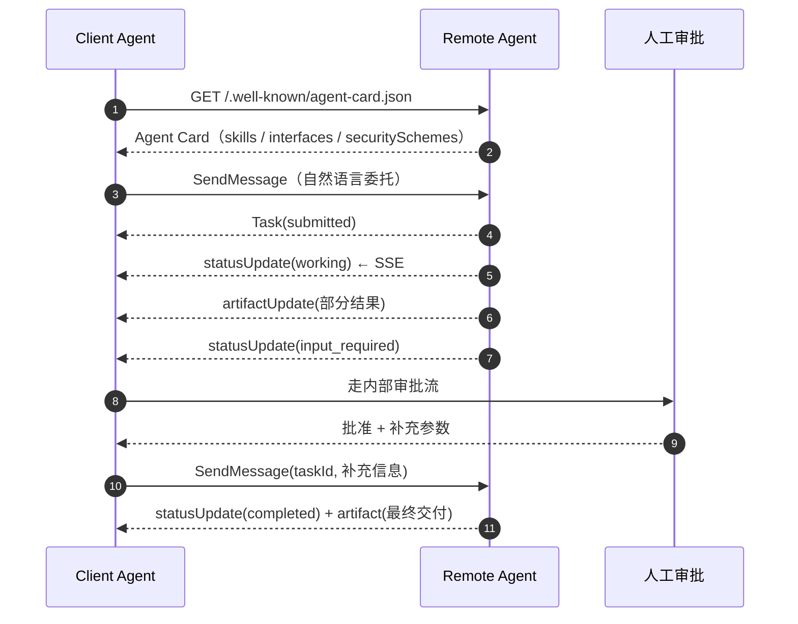

# Agent-to-Agent（A2A）调研报告

> **它是什么、为什么出现、到今天沉淀出了哪些概念**
>
> 版本：v1.0（对应 A2A 规范 1.0）｜整理日期：2026-11-09｜资料截止：2026-11
> 方法：以 A2A 官方规范与 AAIF 公告为主，辅以厂商文档、arXiv 综述与工程实践文章；文中「事实」均可回溯到文末来源，「判断」以（判断）标注。

---

## 0. 一页速览

| 问题 | 一句话回答 |
|---|---|
| A2A 是什么 | 一套让**不同框架、不同厂商、不同组织**的 agent 互相发现、委托任务、交换结果的开放协议 |
| 它解决什么 | 把 agent 之间的 N×N 定制集成，降成「读一张卡 + 走一套状态机」的线性成本 |
| 和 MCP 什么关系 | MCP 是**垂直**的（agent→工具/数据），A2A 是**水平**的（agent→agent），互补而非竞争 |
| 现在谁在管 | Linux Foundation 下的 **Agentic AI Foundation（AAIF）**，与 MCP、AGENTS.md、goose、agentgateway 同一治理体系 |
| 成熟度 | 规范 2026-03 冻结 v1.0；六种语言 SDK；150+ 组织；已有 OS 级与金融级生产案例 |
| 最大的未解问题 | 不是协议本身，而是**身份与委托链**（谁授权、权限怎么逐跳收窄）和**发现层**（目录/注册中心尚未统一） |
| 什么时候不该用 | 单团队、单进程、单框架内部的多个 agent——那是编排框架的事，上协议只会把函数调用变成网络调用 |

**三个必须先分清的概念层次**（后文反复用到）：

1. **协作范式层**：多 agent 如何分工（supervisor、handoff、swarm、debate……）。这是框架内部的事，不一定要协议。
2. **协议标准层**：跨边界时用什么格式说话（A2A 的 Agent Card / Task / Message / Artifact）。
3. **基础设施层**：目录、身份、网关、审计、计费。协议只定义「怎么说话」，不定义「谁有资格说」「说了算不算数」。

> 大多数讨论把三层混为一谈，于是得出「A2A 没用」或「A2A 万能」两种相反的错误结论。

---

## 1. 定义：agent-to-agent 到底指什么

### 1.1 三种用法

「Agent-to-Agent」在中文语境里至少被当作三样东西使用：

| 用法 | 含义 | 典型说法 |
|---|---|---|
| **交互形态** | 一个 agent 把子任务交给另一个 agent，而不是自己调工具 | 「让规划 agent 调检索 agent」 |
| **协议标准** | 特指 Google 发起、现由 AAIF 托管的 A2A 规范 | 「接 A2A」「发一张 Agent Card」 |
| **商业/组织形态** | agent 作为可发现、可调用的服务，形成跨组织的 agent 市场 | 「agent 经济」「agent 目录」 |

本报告以**第 2 种**为主线，但会交代第 1、3 种，因为工程决策真正卡住的地方往往在第 3 层。

### 1.2 一句话定义

> A2A 是一套基于 HTTP 的开放协议，让一个 agent（Client）在不了解对方内部实现的前提下，通过**能力清单（Agent Card）**发现另一个 agent（Server），把工作以**任务（Task）**的形式委托出去，并通过**消息（Message）**与**产物（Artifact）**完成多轮协作与结果交付。

### 1.3 关键设计原则：对端是「不透明」的

这是 A2A 与「把 agent 包成 REST API」最本质的区别。规范明确假设：**你看不到对方的工具、记忆、模型和内部计划**。

| 你拿得到 | 你拿不到 |
|---|---|
| Agent Card（身份、能力、端点、鉴权方式） | 对方的 prompt、模型、工具清单 |
| Task 的 ID、状态、历史 | 对方的内部执行计划与中间推理 |
| Artifact（最终交付物） | 对方的内存与上下文 |

这个约束不是能力缺陷，而是**跨组织协作的前提**：只有「不透明」，供应商才愿意暴露服务而不暴露实现，甲方也才能在不耦合内部的前提下替换供应商。

### 1.4 与普通 RPC / 微服务调用的区别

| 维度 | REST/RPC | A2A |
|---|---|---|
| 抽象单位 | 资源 / 方法 | **任务**（有生命周期、可中断、可取消） |
| 调用时长 | 秒级同步 | 分钟到天级，支持异步与断线重连 |
| 人工介入 | 调用方自己实现 | 协议内置 `input-required` / `auth-required` 状态 |
| 能力发现 | OpenAPI 文档（人读） | Agent Card（**机器可读**，含 skill 与示例） |
| 语义 | 确定性的输入输出 | 自然语言委托，结果质量由对方负责 |
| 鉴权 | 调用方持有凭据 | 凭据随任务流转，支持任务中途追加授权 |

（判断）把 A2A 理解成「带状态机的 RPC」是准确的；把它理解成「agent 版 OpenAPI」则漏掉了任务生命周期这一半。

### 1.5 与 MCP 的边界

规范附录只用一句话区分：

> **MCP 标准化 agent 如何使用工具或资源；A2A 标准化一个 agent 如何把工作委托给另一个 agent。**

工程上的判别方法：

- 你需要的是**确定性能力**（查库、读文件、调 API）→ MCP。
- 你需要的是**判断力**（这件事该怎么做、做完给我什么）→ A2A。

同一个服务可以同时提供两种接口：对内用 MCP 暴露工具，对外用 A2A 暴露能力。两者不是替代关系，一个典型 agent 会「用 MCP 干活，用 A2A 接活」。

---

## 2. 为什么会出现：三个真实痛点

### 2.1 N×N 集成成本

没有协议时，A 团队要接 B、C、D 三个 agent，就要写三套适配；B 再接 C、D，又是两套。集成成本随参与方数量平方增长。A2A 把「每一对写一次」变成「每一方实现一次协议」。

AAIF 的公告把这个动机说得最直白：部署多 agent 系统时反复遇到的同一个问题，是**不同框架构建的 agent 无法在不写定制代码的情况下交接工作**，成本不在 agent 本身，而在 agent 之间的集成。

### 2.2 框架与厂商锁定

LangGraph、CrewAI、AutoGen、ADK、Semantic Kernel 各有自己的 agent 抽象。一旦业务方按某个框架的私有接口对接，换框架等于重写集成。协议层的价值是**把集成资产从框架里拿出来**：Agent Card 是一张 JSON，换平台能带走。

### 2.3 长任务与人工介入无处安放

真实业务里的 agent 任务经常是：跑 20 分钟 → 卡住要人批 → 批完继续 → 产出报告。HTTP 超时、消息队列、工作流引擎都能做，但每家做法不同，跨组织时无法互通。A2A 把这套模式**写进了状态机**：`input-required`、`auth-required`、`completed` 是协议状态，不是各家的私有约定。

---

## 3. A2A 核心概念（v1.0）

### 3.1 三类角色

| 角色 | 说明 |
|---|---|
| **User** | 最终用户，可以是人，也可以是上游自动化服务 |
| **A2A Client（Client Agent）** | 代表用户发起请求的一方；它本身通常也是一个 agent |
| **A2A Server（Remote Agent）** | 暴露 HTTP 端点、实现 A2A 协议的一方；对 Client 不透明 |

注意「Client/Server」是**一次交互中的角色**，不是产品定位。同一个 agent 完全可以既做 Server（接活）又做 Client（把子任务转包出去）。

### 3.2 五个核心对象

| 对象 | 作用 | 关键字段 |
|---|---|---|
| **Agent Card** | 数字名片 + 能力契约 | `name`、`description`、`version`、`supportedInterfaces[]`、`capabilities`、`skills[]`、`securitySchemes`、`signatures[]` |
| **Task** | 有状态的工作单元 | `id`、`contextId`、`status`、`artifacts[]`、`history[]`、`metadata` |
| **Message** | 一轮通信 | `messageId`、`role`（`ROLE_USER` / `ROLE_AGENT`）、`parts[]`、`contextId`、`taskId`、`referenceTaskIds[]` |
| **Part** | 内容容器（模态无关） | `text` / `raw`（内联字节）/ `url` / `data`（结构化 JSON）四选一，外加 `mediaType`、`filename`、`metadata` |
| **Artifact** | 交付物 | `artifactId`、`name`、`description`、`parts[]` |

两个容易混淆的 ID：

- **`contextId`**：会话级，把多个 Task 和独立 Message 串成一个上下文（一次「合作」）。
- **`taskId`**：工作单元级，**终态后不可重启**。想基于结果继续改，必须开新 Task，用同一个 `contextId` + `referenceTaskIds` 指向旧任务。

这条「任务不可变」规则是刻意设计的：它让「输入→输出」有干净的映射，审计和追踪才有锚点。

### 3.3 Agent Card：整个协议的地基

Agent Card 发布在固定路径：

```
https://your-domain/.well-known/agent-card.json
```

> 版本陷阱：0.3 之前是 `/.well-known/agent.json`，2025-07 改名，v1.0 才把新后缀注册进 IANA 的 well-known URI 列表。网上大量 2025 年的教程仍写旧路径。

v1.0 最大的结构变化是 **`supportedInterfaces`**：卡片不再只有一个 `url`，而是一个**有序列表**，每项声明 `protocolBinding`（`JSONRPC` / `GRPC` / `HTTP+JSON`）、`url`、`protocolVersion`，以及可选的租户标识。**顺序即偏好**，客户端按序找第一个自己能说的绑定。

最小示例（字段均为 v1.0 命名）：

```json
{
  "name": "NII 问数 Agent",
  "description": "银行净利息收入（NII）的指标查询、归因分析与临时取数",
  "version": "1.0.0",
  "provider": { "organization": "某银行数据平台", "url": "https://example.com" },
  "supportedInterfaces": [
    { "protocolBinding": "JSONRPC",   "protocolVersion": "1.0", "url": "https://nii.example.com/a2a/jsonrpc" },
    { "protocolBinding": "HTTP+JSON", "protocolVersion": "1.0", "url": "https://nii.example.com/a2a/rest" }
  ],
  "capabilities": { "streaming": true, "pushNotifications": false },
  "defaultInputModes": ["text/plain", "application/json"],
  "defaultOutputModes": ["application/json", "text/markdown"],
  "skills": [
    {
      "id": "nii.query",
      "name": "指标查询",
      "description": "按受治理口径查询 NII 及其分解项；口径版本 v2026.3；仅支持月度/季度粒度",
      "tags": ["nii", "metric", "governed"],
      "examples": ["2026 Q3 的 NII 是多少", "按分行拆解 2026 年 9 月的 NII"],
      "inputModes": ["text/plain"],
      "outputModes": ["application/json"]
    }
  ]
}
```

读这张卡要抓住三点：

1. **`capabilities` 是承诺，不是愿望**。写了 `pushNotifications: false` 或干脆不写，服务端就必须对推送相关操作返回 `PushNotificationNotSupportedError`。
2. **`skills` 是路由依据**。上游 agent 靠它决定「这活要不要给你」；`examples` 的实际作用接近产品文案，写得好不好直接决定被选中的概率。
3. **能力边界要写「不支持什么」**。口径版本、粒度限制、数据截止日这些约束写进 `description`，比写在内部 wiki 里有效得多。

### 3.4 任务状态机：9 个状态

| 状态 | 类别 | 含义 | 客户端该做什么 |
|---|---|---|---|
| `TASK_STATE_SUBMITTED` | 活跃 | 已受理，尚未开始 | 等待 / 订阅 |
| `TASK_STATE_WORKING` | 活跃 | 执行中 | 等待 / 订阅 |
| `TASK_STATE_INPUT_REQUIRED` | **中断** | 需要补充信息（澄清、人工审批） | 带 `taskId` 再发一条 Message |
| `TASK_STATE_AUTH_REQUIRED` | **中断** | 需要额外授权 | 线下取凭据后重发 |
| `TASK_STATE_COMPLETED` | 终态 | 成功，`artifacts[]` 可用 | 取产物 |
| `TASK_STATE_FAILED` | 终态 | 失败 | 读 `status.message` 定位 |
| `TASK_STATE_CANCELED` | 终态 | 已取消 | — |
| `TASK_STATE_REJECTED` | 终态 | 拒绝执行（越权/不支持） | 不要重试，改路由 |
| `TASK_STATE_UNSPECIFIED` | — | proto 零值 | 不应出现在业务逻辑里 |

两条硬规则，违反会直接报错而不是被静默忽略：

- 往**终态任务**再发消息 → `UnsupportedOperationError`。
- 取消**终态任务** → `TaskNotCancelableError`。

### 3.5 十一个操作

| 操作 | 用途 |
|---|---|
| `SendMessage` | 发消息；**默认阻塞**直到终态或中断状态 |
| `SendStreamingMessage` | 同上，但以 SSE / gRPC stream 增量返回 |
| `GetTask` | 按 ID 查任务（轮询的基础） |
| `ListTasks` | 列表 + 过滤 + 游标分页（v1.0 新增） |
| `CancelTask` | 取消 |
| `SubscribeToTask` | 对已存在的任务补订阅流 |
| `CreateTaskPushNotificationConfig` | 注册 webhook |
| `GetTaskPushNotificationConfig` | 查配置 |
| `ListTaskPushNotificationConfigs` | 列配置 |
| `DeleteTaskPushNotificationConfig` | 删配置 |
| `GetExtendedAgentCard` | 取鉴权后的扩展卡 |

**最容易被忽略的一条**：`SendMessage` 默认是阻塞的。除非显式设置 `returnImmediately: true`，否则调用会一直挂到任务进入终态或中断状态。五分钟能答完的任务这样很合理，二十分钟的深度研究就会把网关超时打爆——这通常是「我们的 agent 调用老超时」的第一现场。

### 3.6 三种「任务动了」的通知机制

| 机制 | 原理 | 前提 | 适用 |
|---|---|---|---|
| **轮询** | 客户端周期 `GetTask` | 无 | 穿防火墙、无入站连接 |
| **流式（SSE）** | 单连接持续推送事件 | `capabilities.streaming` | 交互式、需要过程可见 |
| **推送（webhook）** | 服务端回调客户端注册的 URL | `capabilities.pushNotifications` | 超长任务、客户端会离线 |

三者只是**投递方式**不同，事件语义一致：`TaskStatusUpdateEvent`（状态变了）与 `TaskArtifactUpdateEvent`（产物增量）。

webhook 的安全细节写得异常具体，值得单独记：服务端要带 `PushNotificationConfig` 里的凭据、超时 10–30 秒、指数退避重试、**并且应拒绝回调私有地址段**（127.0.0.0/8、10.0.0.0/8、172.16.0.0/12、192.168.0.0/16），防止被注册成内网 SSRF 跳板；接收方要校验 `taskId` 是自己创建的，并假定会重复投递。

### 3.7 三种协议绑定

| 绑定 | 传输 | 特点 | 适用 |
|---|---|---|---|
| **JSON-RPC 2.0** | HTTP POST 单端点 | 最普及，SDK 默认 | Web/服务端通用 |
| **gRPC** | HTTP/2 + protobuf | 强类型、服务端流、性能好 | 内部服务、多语言 |
| **HTTP+JSON（REST）** | 资源化 URL + JSON | 对 API 网关/防火墙最友好 | 企业网关、无 SDK 场景 |

规范要求三种绑定**功能等价**，所以选型是运维问题而非功能问题。

### 3.8 版本协商：清单 + 请求头

v1.0 把版本从卡片级下沉到**接口级**，机制只有两条：

1. 服务端在 `supportedInterfaces` 里把每个版本的每种绑定都列出来（可以同时列 1.0 和 0.3）。
2. 客户端每个请求带 `A2A-Version` 头；**头缺失视为 0.3**，不是「最新版」。

匹配不上就返回 `VersionNotSupportedError`，修法在服务端：补一条 0.3 的接口声明并打开 SDK 兼容开关。这不是内容协商（content negotiation），是「发布列表 + 显式声明」。

### 3.9 安全与身份概念

| 概念 | 说明 |
|---|---|
| `securitySchemes` | 卡片里声明支持的鉴权方式：API Key、HTTP Auth（Bearer/Basic）、OAuth 2.0、OIDC、mTLS |
| OAuth 2.0 流程 | v1.0 支持授权码 + **PKCE**、客户端凭证、**设备码**；移除隐式与密码模式 |
| **卡片签名** | 用 JWS（RFC 7515）对 RFC 8785 规范化后的卡片 JSON 签名，`signatures[]` 可验证来源与完整性 |
| **任务内授权（in-task authorization）** | 执行到一半发现需要额外权限 → 转 `AUTH_REQUIRED` → 客户端线下取凭据后带 `taskId` 重发 |
| **多租户** | 接口上声明租户标识，客户端每次请求回传，服务端据此隔离任务可见性 |

（判断）卡片签名是 v1.0 最被低估的特性。在此之前，「这张卡是不是他家的」只能靠 TLS 域名推断；有了签名，跨组织发现才有最低限度的信任起点。

### 3.10 扩展机制

Agent 可以在卡片里声明自定义扩展，形如 `{uri, description, required, params}`：

- 可选扩展：双方都支持才启用。
- **必需扩展**：客户端不支持就必须失败，而不是降级——避免「以为在用某个语义，其实对方没实现」。

客户端通过 `A2A-Extensions` 头声明自己启用哪些扩展，服务端在响应里回显。扩展点覆盖消息/产物的 `metadata`、新状态、新方法、甚至自定义绑定。

### 3.11 一次完整交互



对应到代码里，服务端实现的核心是「往事件队列里放什么」：先放 `Task`，再放状态更新，再放产物更新，最后放终态。v1.0 开始，顺序错了会抛 `InvalidAgentResponseError`——0.3 时代那种「先回 Message 再补 Task」的写法不再被容忍。

---

## 4. 概念全景：今天到底有哪些概念

把当前生态里的名词按**层**摆开，能看清哪些是竞争对手、哪些是互补件、哪些只是同名。

### 4.1 分层地图

| 层 | 代表概念/项目 | 解决什么 | 与 A2A 的关系 |
|---|---|---|---|
| 指令与上下文 | **AGENTS.md** | 项目如何向 agent 交代约定 | 同栈，不同层 |
| 工具与数据 | **MCP** | agent 调工具、读资源 | 互补（垂直） |
| **协作** | **A2A** | agent 之间发现、委托、交付 | 本体 |
| 支付与商务 | **AP2**、**x402**、Agentic Commerce Protocol | 授权付款、按次结算 | A2A 的扩展或正交层 |
| 目录与发现 | **AGNTCY ADS/OASF**、云厂商 Agent Registry | 跨组织找 agent | A2A 的发现层补充 |
| 传输与安全 | **SLIM**、mTLS、SPIFFE、OAuth 2.0 | 身份、加密、低延迟消息 | A2A 的承载层 |
| 运维 | **agentgateway**、OpenTelemetry | 路由、策略、审计、追踪 | A2A 的数据面 |
| 运行时 | goose、ADK、LangGraph、AgentCore | agent 在哪跑 | 与协议无关 |

### 4.2 协议家族对照

| 协议 | 定位 | 传输/格式 | 发现方式 | 身份模型 | 治理 | 状态（2026-11） |
|---|---|---|---|---|---|---|
| **A2A** | agent↔agent 协作 | JSON-RPC / gRPC / REST | well-known 卡片 + 注册中心 | OAuth2/OIDC/mTLS + 卡片签名 | AAIF | 生产可用，v1.0 |
| **MCP** | agent↔工具/资源 | JSON-RPC（stdio / HTTP） | server capabilities | 传输层鉴权 | AAIF | 事实标准 |
| **ACP（IBM）** | 通用 agent 消息 | REST + MIME multipart | 注册/发现 | DID/角色 | 已归档 | **2025-08 并入 A2A** |
| **ANP** | 开放网络 agent 发现 | JSON-LD 图 | DID 文档 | W3C DID/VC | 社区 / W3C CG | 早期 |
| **AGNTCY** | 目录 + 安全传输 | OASF schema / SLIM（MLS） | ADS 目录 | 可验证身份 | Linux Foundation（Cisco 主导） | 早期但在跑 |
| **AP2** | agent 支付授权 | A2A 扩展 + 签名 Mandate | 随 A2A | 签名凭证 | Google 发起，多伙伴 | 早期 |
| **x402** | 按请求付费 | HTTP 402 + 稳定币 | — | 链上 | Coinbase 等 | 早期，正交 |
| **LangChain Agent Protocol** | 单 agent 的 HTTP 服务契约 | REST | 自描述 | 自建 | LangChain | 不是互操作标准 |

**四个同名陷阱**（评审时最容易吵错）：

1. **ACP** = IBM 的 Agent Communication Protocol（已并入 A2A）≠ AGNTCY 的 **Agent Connect Protocol**（仍在）≠ **Agentic Commerce Protocol**（支付）。
2. **Agent Registry** 在不同云厂商指的不是一回事：有的是治理台账，有的是运行时可发现目录。
3. **Agent Card** 不是 OpenAPI 文档：前者给机器路由用，后者给人集成用。
4. **A2A 的「Server」** 不是「服务端产品」，只是本次交互中接活的一方。

### 4.3 多 agent 协作模式（概念层的另一半）

这些是**框架内部**的模式，多数不需要 A2A；只有跨团队/跨组织时才需要协议承载。

| 模式 | 结构 | 典型实现 | 何时需要协议 |
|---|---|---|---|
| **Supervisor / Orchestrator-Worker** | 中心调度，分派再汇总 | LangGraph supervisor、ADK | 通常不需要 |
| **Handoff / Routing** | 分诊后把控制权整体移交 | OpenAI Agents SDK handoff、Swarm | 跨进程时需要 |
| **Peer Delegation** | 对等 agent 互相委托，无中心 | **A2A** | 需要 |
| **Pipeline / Choreography** | 事件驱动，无中心控制器 | 消息队列 + 事件总线 | 跨组织时需要 |
| **Debate / Critic** | 多角色互评后收敛 | 研究型框架 | 一般不需要 |
| **Blackboard** | 共享工作区，agent 读写 | 自研 | 视边界而定 |

（判断）「A2A 会不会取代编排框架」是个伪问题：编排框架管**进程内/单租户**的协作，A2A 管**进程间/跨信任域**的协作。两者叠加使用才是常态。

---

## 5. 现状快照（2026-11）

### 5.1 治理：已经收敛

- 2025-04 Google 发布 A2A；2025-06 捐给 Linux Foundation，AWS、Cisco、Google、Microsoft、Salesforce、SAP、ServiceNow 为创始组织。
- 2025-08 IBM 的 ACP 并入 A2A，竞争协议退出。
- 2026-03 规范冻结 **v1.0**（首个稳定版）。
- 2026-08-17 以托管项目身份加入 **AAIF**，与 MCP、AGENTS.md、goose、agentgateway 同栈。

「协议选型」这件事的风险已经很低；剩下的风险在**控制面**（谁的目录、谁的身份、谁的网关）。

### 5.2 生态：从「支持」到「生产」

| 维度 | 现状 |
|---|---|
| 组织背书 | 150+ 组织 |
| 社区规模 | 规范仓库约 2.5 万 star（2026-08 数据） |
| SDK | Python、Go、Java、JS、.NET、Rust |
| 云平台 | Google Cloud（ADK / Agent Engine / Cloud Run / GKE）、Azure AI Foundry、AWS Bedrock AgentCore |
| 终端案例 | 华为 Celia 与鸿蒙应用 agent 之间以 A2A 协作；微信等应用接入 OS 助手场景（双授权流程） |
| 金融/商务 | PayPal 与 Google Cloud 用 AP2 把 A2A 延伸到支付授权 |

### 5.3 还没解决的四件事

1. **合规元数据缺失**：监管要的「口径版本、数据截止日、审批人」在 A2A 里没有标准字段，只能塞进 `metadata`——可读，但不可强制、不可校验。
2. **可验证委托凭证缺失**：A→B→C 的链路上，C 拿到的到底是谁的权限？协议没有规定逐跳换发与受众限定，实践中靠网关自行实现。
3. **发现层仍在分裂**：well-known 卡片只解决「知道域名之后怎么找」，跨组织「去哪找有哪些 agent」仍由各家 Registry / AGNTCY / 联邦规范各自回答。
4. **一致性测试缺位**：「支持 A2A」的定义太松，挂个端点也算。跨机构对接前必须自己做版本协商与错误码回归。

---

## 6. 争议与风险

| # | 争议/风险 | 具体表现 | 缓解思路 |
|---|---|---|---|
| R1 | **提示注入跨 agent 传播** | A 的恶意输入经 B 转述后污染 C 的决策 | 每跳做输入隔离与内容分级；不把上游文本当指令 |
| R2 | **混淆代理（confused deputy）** | 把收到的 `Authorization` 直接透传给下游 | 每跳换发**受众限定**的短时凭证，网关强制校验 audience |
| R3 | **webhook SSRF** | 注册内网地址，把回调变成内网探测 | 服务端拒绝私网段（规范已建议），客户端校验 taskId |
| R4 | **技能描述不可靠** | `skills[].description` 是自然语言，路由靠猜 | 写成可判定的契约：输入模式、口径版本、明确不支持项 |
| R5 | **过度工程** | 单团队内部把 12 个节点拆成 12 个 agent | 只在**信任边界/组织边界**用 A2A |
| R6 | **成本不可归因** | 跨 agent 的 token 与调用量算不清 | 在网关注入 trace/租户/任务 ID，按任务聚合 |
| R7 | **版本碎片** | 对方仍是 0.3，首次请求即 400 | 双版本接口声明 + 上线前版本协商测试 |

（判断）R1 与 R2 是这类协议真正的长期难点：它们不是协议 bug，而是「agent 之间有语义信任」这件事本身的副作用。协议能做的只是把边界画清楚，不能替你决定信任谁。

---

## 7. 怎么用：一份最小落地清单

### 7.1 先回答三个问题

1. 有没有**第二个团队/组织**要接？没有 → 先别上协议。
2. 接的是**能力**还是**工具**？工具 → MCP；能力 → A2A。
3. 出事时能不能还原「谁委托、基于什么授权、谁批的」？不能 → 先补审计，再谈协议。

### 7.2 五步落地

1. **写卡**：把现有能力收敛成 3 个以内的 skill，每个写清输入模式、输出模式、口径版本、**明确不支持什么**。
2. **发布**：`/.well-known/agent-card.json` + 签名；卡片进 Git，纳入变更管理（等同模型变更）。
3. **包一层**：用官方 SDK 在现有服务**外面**加 server，内部图/工作流不改。
4. **加网关**：JWT 鉴权 + 按 skill 的 RBAC + 审计日志 + 每跳换发短时凭证。
5. **打通一条链**：委托 → `input-required` → 人工审批 → 返回 → 审计还原。这条链不通，其他都是空谈。

### 7.3 不同角色的读法

| 角色 | 重点章节 | 一句话 |
|---|---|---|
| 架构师 | 3.3–3.9、4.1 | 协议只放在边界，内部不拆 |
| 后端工程师 | 3.5–3.11 | 先搞懂 `SendMessage` 默认阻塞和事件顺序 |
| 安全 | 3.9、6 | 委托链与受众限定是命门 |
| 产品 | 3.3、7.1 | skill 的 `examples` 就是对外说明书 |
| CTO | 0、5、6 | 协议风险已低，控制面风险仍高 |

---

## 8. 术语表

| 术语 | 含义 |
|---|---|
| **Agent Card** | agent 的机器可读名片，含能力、端点、鉴权方式、签名 |
| **Skill** | agent 对外声明的一项能力，路由的基本单位 |
| **Task** | 有生命周期的工作单元，终态后不可重启 |
| **Context** | 会话级标识，聚合多个 Task 与 Message |
| **Message** | 一轮通信，由若干 Part 组成 |
| **Part** | 内容容器：文本 / 内联字节 / URL / 结构化数据 |
| **Artifact** | 任务产出的交付物 |
| **Binding** | 协议承载方式：JSON-RPC / gRPC / HTTP+JSON |
| **Push Notification** | 服务端回调客户端 webhook 的投递方式 |
| **Extended Agent Card** | 鉴权后才可见的扩展卡片（含敏感能力） |
| **Extension** | 协议的可选/必需扩展点 |
| **In-task Authorization** | 任务执行中途追加授权的机制 |
| **Multi-tenancy** | 单端点服务多租户，按租户隔离任务 |
| **Opaque Agent** | 对端不暴露内部工具/记忆/计划的设计前提 |
| **Well-known URI** | `/.well-known/agent-card.json` 固定发现路径 |
| **Delegation Chain** | A→B→C 的委托链，身份与权限沿链收窄 |
| **Agent Registry** | agent 目录/台账，发现层的实现形态 |
| **AAIF** | Agentic AI Foundation，Linux Foundation 下的 agent 栈治理机构 |

---

## 9. 结论

1. **概念上**：A2A 把「agent 互调」从私有 RPC 提升为带任务生命周期的开放协议；它的核心不是传输格式，而是**能力契约（Agent Card）+ 状态机（Task）+ 不透明原则**。
2. **生态上**：协议战已基本结束（v1.0 + AAIF + 150 组织 + 六语言 SDK），竞争转移到发现层与身份层，这两层目前没有赢家。
3. **工程上**：收益与参与方数量强相关。只有 1 个消费方时，A2A 是负债；有 3 个以上跨团队消费方时，它是资产。
4. **风险上**：真正的坑不在协议实现，而在**委托链的权限收窄**与**审计能否还原业务语义**——这两件事协议不管，必须自己设计。

> 相关文档：面向本项目的决策建议、平台选型与 90 天路径，见 [竞品分析-Agent-to-Agent协议与平台](./竞品分析-Agent-to-Agent协议与平台.md)。

---

## 参考来源

**规范与官方文档**

- A2A 规范（v1.0）：https://a2a-protocol.org/latest/specification/
- What's New in v1.0：https://a2a-protocol.org/latest/whats-new-v1/
- Core Concepts：https://a2a-protocol.org/latest/topics/key-concepts/
- Life of a Task：https://a2a-protocol.org/latest/topics/life-of-a-task/
- A2A GitHub 仓库与 SDK：https://github.com/a2aproject/A2A

**治理与公告**

- AAIF《A2A joins AAIF's open agentic stack》(2026-08-17)：https://aaif.io/blog/a2a-joins-aaif
- A2A 官方博客《A New Chapter for A2A: Joining the Agentic AI Foundation》(2026-08-27)：https://a2a-protocol.org/latest/blog/2026/08/27/a-new-chapter-for-a2a-joining-the-agentic-ai-foundation/
- AAIF《A2A v1.0 Builder's Guide, Part 1》(2026-08-27)：https://aaif.io/blog/a2a-v1-0-a-builder-s-guide-part-1-discovery-tasks-and-clients

**研究与综述**

- Ehtesham et al.《A survey of agent interoperability protocols: MCP, ACP, A2A, ANP》(arXiv:2505.02279)：https://arxiv.org/abs/2505.02279

**生态项目**

- MCP：https://modelcontextprotocol.io
- agentgateway：https://agentgateway.dev/docs/standalone/latest/documentation/about/introduction/
- AGNTCY 文档：https://github.com/agntcy/docs

> 说明：协议规范仍在演进，厂商「支持 A2A」的口径不一。涉及具体版本号、字段名与行为约束时，以 `a2a-protocol.org` 当日规范为准；本文档中的状态与数字为 2026-11 快照。
